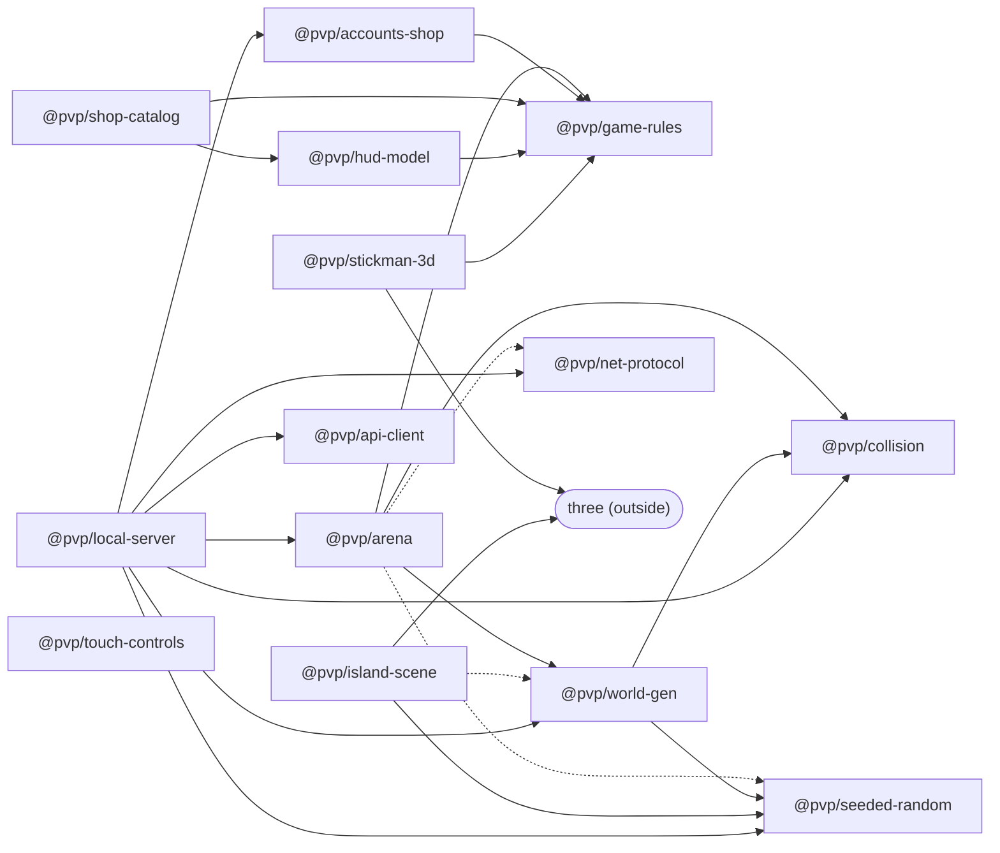

# Package catalog

This is the list of our reusable packages in [`packages/`](packages/), the building blocks of **PvP Island**. Each one is a small piece
that works on its own, so it can be used in this game **and in other games too**. Every package
follows the template in [packages/README.md](packages/README.md): an ES module with `src/index.js`,
tests with `node:test`, and a README with "What it does", "How to use" and "Determinism".

`npm run catalog:check` (also part of `npm test`) fails if a package folder is missing here
or does not follow the template.

## Who depends on whom

An arrow `A --> B` means "A uses B". Dotted arrows are only used in tests.

`@pvp/api-client`, `@pvp/touch-controls`, `@pvp/collision`, `@pvp/game-rules`,
`@pvp/net-protocol` and `@pvp/seeded-random` need no other package.

## All packages

| Package | What it does | Runs in | Determinism | Tests |
|---|---|---|---|---|
| `@pvp/seeded-random` | Random numbers from a seed: same seed, same numbers. | both | fully: only the seed and the calls decide | 11 |
| `@pvp/game-rules` | All the game's numbers (the boss's weapons and shields, rarities and their colors, chest weights, which guns can aim, the Healing Potion, the bombs, skins, prices, limits) as frozen data. | both | fully: constant data and pure helpers | 32 |
| `@pvp/collision` | Walls, jumping, landing and ray hits in a world made of boxes. | both | fully: pure math, no random, no time | 19 |
| `@pvp/world-gen` | Builds the island of ruins (houses, towers, chests) from a seed. | both | fully: all random comes from the seed | 12 |
| `@pvp/net-protocol` | Every message between phone and server, with builders and checks. | both | fully: pure functions and frozen data | 21 |
| `@pvp/accounts-shop` | Accounts, log in, coins, buying skins, weapons, potions and bombs, the Inventory and the 5-slot fast bar (only the bar goes into the arena). | Node (browser via `/browser`) | partly: logic is pure, tokens/clock are passed in, file saving is real I/O | 45 |
| `@pvp/arena` | The fight itself: players, chests, loot, weapons, shields, shock and freeze, drinking potions, aiming, thrown bombs, damage, knockouts, damage numbers for nearby players. | both | fully: time and seeded random are passed in (replay tests) | 133 |
| `@pvp/shop-catalog` | Turns the rules and an account into the cards the shop screen shows, and the Inventory screen: spaces (at least 2 of everything) and the fast bar. | both | fully: pure functions of their inputs | 21 |
| `@pvp/hud-model` | Turns your inventory and health into the in-game HUD: Durability bar of the held weapon, H.P bar, 5 slots, shield pill, potion button with drinking ring, "Charging 1.4s" after a shot, damage numbers above heads, aiming (zoom, scope ring, AIM / AIM ON button), bomb buttons, the coin icon from the boss's drawing. | both | fully: pure functions of their inputs (time passed in) | 42 |
| `@pvp/api-client` | Talks to the server's account, shop and Inventory/fast bar API and keeps the login token. | both | fully: fetch and storage are passed in | 11 |
| `@pvp/stickman-3d` | A three.js stickman with skins, outfits, the boss's weapons and shields, the Healing Potion flask, bombs and their red area, frozen/shocked looks and animation. | browser (pose math also in Node) | partly: pose math is pure, how it looks depends on the renderer | 27 |
| `@pvp/island-scene` | The 3D island: sky with clouds, warm sun, green grass ground with dirt paths, grass tufts, flowers, bushes, rocks, beach with wet sand, waves, palms, ruins and chests, and gold coins popping out of opened chests. A lighter version for phones. | browser (also builds in Node) | partly: all placement and colors from a seed, time passed in, how it looks depends on the renderer | 19 |
| `@pvp/local-server` | The game server inside the page (practice mode): arena, accounts in localStorage, tick, fake WebSocket, bots. | browser (also Node) | partly: seeded arena and bots, time and timer passed in; tokens and localStorage are real | 17 |
| `@pvp/touch-controls` | Joystick, aim by dragging, buttons, held actions (shield), toggled actions (aim: on until pressed again), buttons that hide and show, keyboard and mouse (right click aims). | browser (core also in Node) | partly: the core is pure, the DOM part depends on real fingers and mice | 27 |

"Both" means Node and the browser (in the browser, `@pvp/*` imports need an import map or a bundler).

---

## `@pvp/seeded-random`

**Purpose:** random numbers you can replay. Same seed gives the same numbers, in Node and the browser.

| Export | Example |
|---|---|
| `createRandom(seed)` | `const r = createRandom(1234); // or createRandom('island-1')` |
| `r.int` / `r.range` / `r.chance` | `r.int(1, 6); r.range(-5, 5); r.chance(0.25);` |
| `r.pick` / `r.shuffle` | `r.pick(['a', 'b']); r.shuffle([1, 2, 3]); // new array` |
| `r.fork(label)` | `const loot = r.fork('loot'); // own stream, parent not moved` |
| `r.state()` / `createRandom.fromState` | `const again = createRandom.fromState(r.state());` |
| `hashString(str)` | `hashString('abc'); // 32-bit number (FNV-1a)` |

**Depends on:** nothing.
**Determinism:** fully. No `Math.random`, no time. One extra draw changes everything after it, so give each system its own `fork`.

## `@pvp/game-rules`

**Purpose:** all the game's rules as frozen plain data (limits, movement, the boss's weapons and shields with their specials, the starting weapon, rarities and their colors, chest weights and coins, the Healing Potion, colors, outfits, prices), plus small helpers.

| Export | Example |
|---|---|
| `WEAPONS`, `COLORS`, `OUTFITS`, `MAX_HP` | `WEAPONS.icesword.freezeMs; // 2000` |
| `POTION`, `MAX_POTIONS`, `potionHeal` | `POTION.drinkMs; // 5000: the only heal, full H.P` |
| `BOMBS`, `isBomb`, `bombPrice`, `bombMaxCarry`, `bombCounts`, `inBombArea` | `BOMBS.legendarybomb.area; // 5 (a 5x5 m square)` |
| `STARTING_WEAPON` | `'gun'`: everyone gets it on join |
| `RARITIES`, `RARITY_COLORS`, `rarityStyle(r)` | `RARITY_COLORS.epic.color; // purple` |
| `chestChance(id)`, `CHEST_COINS`, `GOLDEN_CHEST_COINS`, `GOLDEN_CHEST_BOOST` | `chestChance('gun'); // 15 (a weight: 15 / 54.8 of chests)` |
| `isShield(id)`, `rarityRank(r)` | `isShield('megashield'); // true (worn on the arm, no slot)` |
| `droppedDurability(id, usesLeft)` | `droppedDurability('gun', 3); // 8 (half, rounded up)` |
| `CHARGING_DAMAGE`, `MIN_FIRE_GAP_MS`, `chargingDamage(dmg)` | `chargingDamage(15); // 4: a hit while the weapon still charges does 25% (#38)` |
| `HEADSHOT_BONUS`, `HEAD_ZONE`, `isHeadshot(h, height)`, `headshotDamage(dmg)` | `headshotDamage(2); // 5: a gun bullet in the top 0.35 m of a player does +3 (#45)` |
| `aimDef(weapon)`, `canAim(id)`, `aimMultipliers(weapon, aiming)` | `aimDef('shootbm'); // { zoom: 2, spreadMul: 0.3, moveMul: 0.6 }: only the Shootbm and the DM Gun can aim (#37)` |
| `RULES` | `createArena({ rules: RULES, ... }) // everything in one object` |
| `weaponPrice(id)` / `skinPrice(slot, id)` | `weaponPrice('gun'); // 3` |
| `isBuyable(kind, id)` | `isBuyable('weapon', 'supersword'); // true` |
| `weaponsByRarity(rarity)` | `weaponsByRarity('epic'); // ['electricsword', 'icesword', 'shield']` |
| `validateRules(rules)` | `validateRules(RULES); // [] means valid` |

**Depends on:** nothing.
**Determinism:** fully. Constant data and pure functions; all data is frozen.

## `@pvp/collision`

**Purpose:** collision and movement math for a world made of boxes.

| Export | Example |
|---|---|
| `createBoxGrid(boxes, opts)` | `const grid = createBoxGrid(boxes, { cellSize: 10 }); grid.near(x, z, 2);` |
| `circleHitsBox(x, z, r, box)` | `circleHitsBox(0, 0, 0.45, box); // true if they overlap` |
| `movePlayer(grid, body, dx, dz, dt, opts)` | `movePlayer(grid, body, dx, dz, dt, { radius: 0.45, height: 1.85, stepHeight: 0.55, gravity: 24 });` |
| `rayBoxes(grid, origin, dir, maxDist)` | `rayBoxes(grid, eye, dir, 120); // nearest box or ground, else Infinity` |
| `rayBox(origin, dir, box)` | `rayBox(eye, dir, box); // distance or Infinity` |
| `rayCylinder(origin, dir, cyl)` | `rayCylinder(eye, dir, { x, y, z, height: 1.85, radius: 0.55 });` |
| `rayCylinderHit(origin, dir, cyl)` | `rayCylinderHit(eye, dir, cyl); // { t, y, h } or null: h = hit height above the feet (headshots, #45)` |

**Depends on:** nothing.
**Determinism:** fully. Pure functions; `near()` returns boxes in input order, so walls are resolved in a fixed order.

## `@pvp/world-gen`

**Purpose:** builds the island of ruins (plaza, houses, towers, colonnades, walls, rocks, chests, golden spots) from a seed, picks spawn points and checks a map.

| Export | Example |
|---|---|
| `generateIsland(opts)` | `const island = generateIsland(); // today's map (seed 20261020)` |
| `generateIsland({ seed, ... })` | `generateIsland({ seed: 'my-map', islandRadius: 100, houses: 10 });` |
| `findSpawn(island, players, random, opts)` | `findSpawn(island, players, createRandom(1), { minDistanceFromOthers: 25 });` |
| `validateIsland(island)` | `validateIsland(island); // [] when fine` |
| `DEFAULT_SEED`, `DEFAULT_OPTIONS` | `generateIsland({ ...DEFAULT_OPTIONS, rocks: 30 });` |

**Depends on:** `@pvp/seeded-random`, `@pvp/collision`.
**Determinism:** fully. All randomness comes from the seed. Changing any option changes the rest of the map (the builders share one random stream).

## `@pvp/net-protocol`

**Purpose:** every message between the phone and the server in one place ([PROTOCOL.md](packages/net-protocol/PROTOCOL.md)), with helpers to build and check them, so bad messages are rejected.

| Export | Example |
|---|---|
| `parseClientMessage(raw)` | `const r = parseClientMessage(raw); if (r.ok) handle(r.msg);` |
| `encode(type, fields)` | `ws.send(encode('coins', { amount: 10, total: 130 }));` |
| `encodeClient(type, fields)` | `ws.send(encodeClient('fire', { d: [0, 0, 1] }));` |
| `decodeServerMessage(raw)` | `const r = decodeServerMessage(event.data);` |
| `packSnapshotPlayer` / `unpackSnapshotPlayer` | `encode('snap', { p: [packSnapshotPlayer(p)], n: 1 });` |
| `makeFlags` / `readFlags` | `readFlags(flags); // crouch, slide, moving, air, aim (FLAG_AIM = 16, #37)` |
| `makeStatus` / `readStatus` | `readStatus(snap[SNAP.STATUS]); // shieldUp, shocked, frozen` |

**Depends on:** nothing.
**Determinism:** fully. Pure functions and frozen data. The only setting is `setEncodeChecks(on)`.

## `@pvp/accounts-shop`

**Purpose:** player accounts (sign up, log in, log out, rename), coins, the shop (buy and equip skins, buy weapons, potions and bombs into the Inventory) and the fast bar (#39): 5 slots filled from the Inventory; only the bar is taken into the arena, the Inventory stays safe. Storage is pluggable. Node entry, plus `@pvp/accounts-shop/browser` (no Node imports, hashing passed in).

| Export | Example |
|---|---|
| `createAccounts({ store })` | `const accounts = createAccounts({ store: createMemoryStore() });` |
| `accounts.signup` / `accounts.login` | `const { token, account } = accounts.signup('Stick_Kid', 'secret');` |
| `accounts.buy` / `accounts.equip` | `accounts.buy(acc, 'hat', 'crown'); accounts.equip(acc, 'hat', 'crown');` |
| `accounts.toBar` / `fromBar` | `accounts.toBar(acc, 'potion', 'potion', { slot: 2 }); accounts.fromBar(acc, 0); // checked: must own it, 1 shield, stacks capped` |
| `accounts.takeBar` | `const { loadout, potions, bombs, starter } = accounts.takeBar(acc); // ONLY the bar goes into the arena` |
| `accounts.returnFromArena` | `accounts.returnFromArena(acc, { weapons, potions, bombs }); // back into the bar slots, loot into the Inventory` |
| `createJsonFileStore(file, opts)` | `createJsonFileStore('data/accounts.json', { saveDelayMs: 1000 });` |
| `createWebStorageStore(storage, key)` | `createWebStorageStore(localStorage, 'pvp.accounts'); // memory if blocked` |
| `accounts.rename` | `accounts.rename(acc, 'New_Name');` |
| `AccountError` | `catch (e) { if (e.code === 'NAME_TAKEN') ... }` |

**Depends on:** `@pvp/game-rules` (and Node's `crypto` and `fs`).
**Determinism:** partly. Shop and loadout logic is pure. Tokens, salts and timestamps come from the injected `randomBytes` and `now`, so tests are repeatable. The JSON file store writes real files on a timer.

## `@pvp/arena`

**Purpose:** the fight as a simulation with no sockets and no clock: join and leave, movement checks, weapons (melee and guns), shields on the arm (front blocks, wear, Mega Shield reflect), shock and freeze, instant knockout, chests and the golden chest (one weapon each, picked by the weapons' chest weights), loot, damage and knockouts (dropped weapons with half or less durability come back at half). Everyone joins with the starting Gun. The server calls methods and `tick(now)`, then sends what `drain()` returns.

| Export | Example |
|---|---|
| `createArena(opts)` | `const arena = createArena({ island: generateIsland(), rules: RULES, random: createRandom(1234), now: 0 });` |
| `arena.join` / `arena.leave` | `const r = arena.join('alice', { name: 'Alice', skin, loadout: ['shootbm', 'shield'], starter: false }, now); // starter: false = no free Gun (#39)` |
| `arena.setState` / `arena.fire` | `arena.fire(id, [dx, dy, dz], now); // each slot charges on its own; charging = 25% damage (#38); a gun headshot +3 (#45)` |
| `arena.aimState(id)`, `AIM_FLAG` | `arena.aimState(id); // { aiming: true, zoom: 2, spreadMul: 0.3, moveMul: 0.6 } while state.f has 16 and a Shootbm / DM Gun is in hand (#37)` |
| `arena.setShield` | `arena.setShield(id, true, now); // raise the shield (no firing while up)` |
| `arena.dropWeapon` | `arena.dropWeapon(id, now); // drop the weapon in hand, exact durability (#34)` |
| `arena.openChest` | `arena.openChest(id, 3, now); // or 'golden'` |
| `arena.drink` | `arena.drink(id, now); // Healing Potion: full H.P after 5 s, a slot change wastes it` |
| `arena.throwBomb` | `arena.throwBomb(id, 'bomb', [dx, dy, dz], now); // explodes 3 s later, in tick` |
| `arena.setCoins` | `arena.setCoins(id, account.coins); // the account's total wins, queues an 'inv'` |
| `arena.tick` / `arena.drain` | `arena.tick(now); for (const ev of arena.drain()) send(ev); // ev.to: id, 'all', 'server' or a list of ids` |
| damage numbers (#33) | `{ to: [ids near the victim], msg: { t: 'dmg', id, amount, ko?, blocked?, shock? } }` |
| `ARENA_DEFAULTS` | `createArena({ ..., tuning: { ...ARENA_DEFAULTS, snapshotRadius: 200 } });` |

**Depends on:** `@pvp/collision`, `@pvp/game-rules`, `@pvp/world-gen` (tests also use `@pvp/seeded-random` and `@pvp/net-protocol`).
**Determinism:** fully. Time is passed in and all randomness comes from the seeded `random` (forked per system). Same seed and same calls give the same outbox; there is a replay test.

## `@pvp/shop-catalog`

**Purpose:** pure functions that turn the rules and an account into what the shop screen shows (tabs, item cards with buy/equip state) and what the Inventory screen shows (#39): a space per item copy or stack, at least 2 of every item (empty "ghost" spaces too), and the 5-slot fast bar.

| Export | Example |
|---|---|
| `shopTabs()` | `shopTabs(); // [{ id: 'color', label: 'Colors', hint }, ...]` |
| `shopItems(tab, account)` | `shopItems('hat', account); // cards with action 'buy' / 'equip' / 'equipped'` |
| `potionCard(account)` | `potionCard(account); // the Healing Potion card (tab 'potion')` |
| `bombCards(account)` | `bombCards(account); // the Bomb and Legendary Bomb cards (tab 'bomb')` |
| `shopWeaponIds(rules)` | `shopWeaponIds(); // every weapon, sorted by rarity, then price` |
| `inventorySummary(account)` | `inventorySummary(account); // 'Inventory: 2× Shootbm, 1× Supersword' (old name: backpackSummary)` |
| `inventoryCards(account)` | `inventoryCards(account); // [{ key, kind, id, name, icon or iconSvg, rarityColor, filled, ghost, count, label, durability, action: 'toBar' }, …]` |
| `barSlots(account)` | `barSlots(account); // 5 slots: { index, key: '1', empty, name, icon, count, label, action: 'fromBar' }` |
| `barSummary(account)` | `barSummary(account); // 'Fast bar: DM Gun, 3× Healing Potion (3 free)'` |
| `inventoryItemKinds` / `spaceSize` / `itemLook` / `MIN_SPACES` | `spaceSize('potion', 'potion'); // 3 (a space holds as much as a bar slot)` |
| `swatchBackground(card)` | `el.style.background = swatchBackground(card);` |
| `OUTFIT_ICONS` | `OUTFIT_ICONS.hat.crown; // '👑'` |

**Depends on:** `@pvp/game-rules`, `@pvp/hud-model` (the icons).
**Determinism:** fully. Pure functions of their inputs; fixed sort order.

## `@pvp/hud-model`

**Purpose:** pure functions that turn the `inv` message and your health into what the in-game HUD shows (the boss's drawing): the Durability bar of the weapon you hold, the H.P bar with its percent, always all 5 weapon slots (empty ones too), the small Shield pill, which slot a key picks, the "Charging 1.4s" text under the crosshair, the damage numbers above heads, and the coin icon (the boss's drawing: almost square, cut corners, a "P", sparkle lines).

| Export | Example |
|---|---|
| `slotBar(inv, rules)` | `slotBar(inv); // 5 slots: { index, key, weapon, name, icon, rarity, active, empty, durability }` |
| `durabilityView(id, usesLeft)` | `durabilityView('icesword', 7); // { ratio: 0.14, level: 'critical', … } or null` |
| `heldDurabilityView(inv, rules)` | `heldDurabilityView(inv); // { ratio, percent, level, label: '75%' or '∞', infinite, empty, … }` |
| `healthView(hp)` | `healthView(30); // { hp: 30, percent: 30, low: true, text: '30', label: '30%', … }` |
| `pickSlot(inv, action)` | `pickSlot(inv, '+'); // next filled slot, or null` |
| `brokeMessage(id)` | `brokeMessage('shootbm'); // 'Your Shootbm broke!'` |
| `shieldView(inv, up)` | `shieldView({ shield: { id: 'shield', dur: 45 } }); // { name: 'Shield', label: '45', percent: 75, … } or null` |
| `potionView(inv, { drink, now })` / `drinkState` | `potionView(inv, { drink, now }).progress; // drinking ring 0..1` |
| `POTION_ICON_SVG` | `btn.innerHTML = POTION_ICON_SVG; // the flask from the drawing` |
| `bombView(inv)` / `bombIconSvg(color)` / `BOMB_KEYS` | `bombView(inv)[0]; // { id: 'bomb', count: 4, max: 5, key: 'B', … }` |
| `chargeView(weaponDef, lastFireAt, now)` | `chargeView(RULES.WEAPONS.gun, 1000, 1600).text; // 'Charging 1.4s' (hint '25%'; then 'Ready!', then hidden)` |
| `aimView(weapon, { on, blocked, blend })`, `aimBlend(prev, on, dtMs)`, `zoomedFov(fov, zoom)` | `aimView('shootbm', { on: true }); // { canAim, aiming, zoom: 2, moveMul: 0.6, cameraDistance, crosshairScale, scope, … } (#37)` |
| `aimButtonView(on, { paused })`, `aimHandKey(inv)` | `aimButtonView(true).label; // 'AIM ON' (#40); aimHandKey(inv) // '1:shootbm': aiming switches off when it changes` |
| `chargeStarts(inv, now, prev)` | `chargeStarts({ weapons: ['gun', 'shootbm'], charge: [0, 2700] }, now); // per slot lastFireAt for chargeView (#38)` |
| `damageNumber(msg)` / `damageFloat(age)` | `damageNumber({ t: 'dmg', id: 3, amount: 15 }).text; // '-15'; damageFloat(1000) // { rise, opacity, scale, done }` |
| `hitMarker(msg)`, `HEADSHOT_MARKER_SCALE` | `hitMarker({ t: 'hitmark', dead: false, head: true }); // { kind: 'head', scale: 1.6, color: orange } (#45; a headshot number: '-5' badge 'HEADSHOT')` |
| `COIN_ICON_SVG` / `coinIconSvg(opts)` / `coinIconDataUrl()` | `el.innerHTML = COIN_ICON_SVG; coinIconSvg({ label: 'PvP', sparkle: false }); // CSS: url("${coinIconDataUrl()}")` |
| `coinsToast(amount)` | `coinsToast(3).text; // '+3 coins'` |
| `WEAPON_ICONS` | `WEAPON_ICONS.icesword; // '❄️'` |

**Depends on:** `@pvp/game-rules`.
**Determinism:** fully. Pure functions of their inputs; durability levels: green above 50 %, yellow 20-50 %, red below 20 %.

## `@pvp/api-client`

**Purpose:** talks to the server's account and shop API (sign up, log in, me, buy, equip, the Inventory and the fast bar) and remembers the login token, with friendly error messages.

| Export | Example |
|---|---|
| `createApiClient(opts)` | `const api = createApiClient({ storage: localStorage });` |
| `api.signup` / `api.login` | `const { account } = await api.login('Bob', 'secret');` |
| `api.me` | `const { account, online } = await api.me();` |
| `api.buy` / `api.equip` | `await api.buy('hat', 'crown');` |
| `api.inventory` / `api.toBar` / `api.fromBar` | `await api.toBar('weapon', 'icesword', { slot: 0 }); await api.fromBar(0); // #39` |
| `ApiError` | `catch (e) { show(e.message); /* e.status 0 = no connection */ }` |
| `safeStorage(storage)` | `const s = safeStorage(localStorage); s.set('k', 'v');` |

**Depends on:** nothing.
**Determinism:** fully. No randomness and no clock; `fetch` and storage are passed in, so tests use fakes.

## `@pvp/stickman-3d`

**Purpose:** a three.js stickman: skin colors and patterns, outfits, a weapon in hand (models from the boss's cards), a shield on the left arm, frozen / shocked looks, and walk / crouch / slide / jump / aim / swing / shield-up animation.

| Export | Example |
|---|---|
| `Stickman` | `const sm = new Stickman({ color: 'rainbow', hat: 'crown' }); scene.add(sm.root);` |
| `sm.setWeapon` / `sm.animate` | `sm.setWeapon('icesword'); sm.animate(dt, { speed, crouch }, time);` |
| `sm.setShield` / `sm.shieldUp` | `sm.setShield('megashield'); sm.shieldUp = true;` |
| `sm.setStatus` | `sm.setStatus({ frozen: true, shocked: false }); // ice block / lightning` |
| `buildWeapon(id)` | `const loot = buildWeapon('supersword'); loot.userData.update?.(time); // a THREE.Group` |
| `buildPotion()` / `holdPotion(sm, on)` | `scene.add(buildPotion()); holdPotion(sm, true); // drinking` |
| `buildBomb(id)` / `buildBombArea(side)` | `scene.add(buildBomb('legendarybomb'), buildBombArea(5)); // gold bomb, red 5x5 square` |
| `computePose(state, prev, dt)` | `const pose = computePose({ speed: 3, time }, null, dt);` |
| `weaponModelKind(id)` | `weaponModelKind('shootbm'); // 'special:shootbm'` |
| `disposeObject(obj)` | `disposeObject(loot); // free geometries and materials` |

**Depends on:** `@pvp/game-rules`, and `three` (peer dependency).
**Determinism:** partly. `computePose`, `rainbowHue` and `weaponModelKind` are pure and take time as input; what shows on screen depends on the renderer.

## `@pvp/island-scene`

**Purpose:** the three.js scenery of an island from `@pvp/world-gen`: sky dome with sun glow and clouds, warm lights and shadows (desktop), a green grass ground (seeded color texture with lush and lighter patches, worn dirt around the ruins and a few paths, times a small tiling grass detail), grass tufts, flowers, bushes and rocks (instanced), a beach from dry to wet sand with foam, water with drifting waves, palms, ruins of light sandy stone with mossy feet, chests with a lid that opens backwards, the golden chest, and the coin pop (a few square gold coins jump out of an opened chest and fade).

| Export | Example |
|---|---|
| `createIslandScene(opts)` | `const isl = createIslandScene({ island: generateIsland(), mobile, random: 'island-scene' }).addTo(scene);` |
| `isl.update(dt, time, focus)` | `isl.update(dt, time, { x: me.x, z: me.z }); // sky, water and sun follow the focus` |
| `isl.chests` | `isl.chests.setOpen(3, true); isl.chests.isOpen(3); isl.chests.closeAll();` |
| `isl.golden` | `isl.golden.show(x, z); isl.golden.hide();` |
| `buildChest({ golden })` | `scene.add(buildChest()); // one chest model, lid in userData.lid` |
| `isl.popChestCoins(i)` / `isl.popGoldenCoins(x, z)` | `isl.popChestCoins(3); // 6 coins jump out (4 on phones), moved by isl.update()` |
| `buildCoin()` / `createCoinPops(opts)` | `scene.add(buildCoin()); const pops = createCoinPops({ max: 12, random: 1 }); pops.burst(x, y, z, { count: 5 }); pops.update(dt);` |
| `noiseTexture(random, opts)` | `noiseTexture(createRandom(1), { blocks: true, cracks: 6 });` |
| `createGroundField(opts)` | `const f = createGroundField({ islandRadius: 210, boxes, random: createRandom(1), size: 256 }); f.sample(x, z).dirt;` |
| `buildPlants(opts)` / `PLANT_COUNTS` | `PLANT_COUNTS.mobile.tufts; // 4200 (desktop 14000)` |
| `grassDetailPixels`, `heightToNormalPixels`, `waterNormalTexture`, `fbm`, `valueNoise` | `fbm(createRandom(2), { cells: 8 })(0.3, 0.7); // tiling noise, 0..1` |
| `mobile: true` | lighter for phones: smaller textures, ~30% of the plants, fewer clouds, Lambert materials, no normal maps, no shadows |

**Depends on:** `@pvp/seeded-random`, and `three` (peer dependency). Tests also use `@pvp/world-gen`.
**Determinism:** partly. Every random placement, shade and texture comes from a seeded random (one fork per part), so the same seed gives the same scenery; time is passed in to `update()`. How it looks on screen depends on the renderer.

## `@pvp/local-server`

**Purpose:** the game server's glue running in the page, for practice mode with no network: island, arena (seeded), accounts and shop saved in `localStorage`, the 50 ms tick, a WebSocket-like connection speaking the `@pvp/net-protocol` messages, a `fetch` for `@pvp/api-client`, and simple bots.

| Export | Example |
|---|---|
| `createLocalServer(opts)` | `const server = createLocalServer({ seed: 'abc', storage: localStorage, bots: 3 });` |
| `server.createApi()` / `server.ensurePlayer()` | `const api = server.createApi(); server.ensurePlayer(); // a local player, no login` |
| `server.connect(token)` | `const ws = server.connect(api.token); ws.onmessage = e => ...; ws.send(text);` |
| `server.rename` / `server.teleport` | `server.rename(api.token, 'Boss_Kid');` |
| `server.tick(now)` | `createLocalServer({ autoStart: false, now }); server.tick(); // tests` |
| `createBots(opts)` | `const bots = createBots({ arena, island, random: createRandom('b'), count: 3 }); bots.tick(now);` |
| `createFakeSocket(opts)` | the WebSocket-like object (send, close, readyState, onopen/onmessage/onclose) |

**Depends on:** `@pvp/arena`, `@pvp/accounts-shop` (browser entry), `@pvp/api-client`, `@pvp/net-protocol`, `@pvp/world-gen`, `@pvp/seeded-random`, `@pvp/collision`, `@pvp/game-rules`.
**Determinism:** partly. The arena and bots use seeded randoms and time/timer are passed in, so tests replay exactly; login tokens use `crypto.getRandomValues` unless `randomBytes` is passed, and `localStorage` is real storage.

## `@pvp/touch-controls`

**Purpose:** game controls for phones and computers: joystick, drag to aim, buttons, held actions (hold Shift or the shield button to raise the shield), toggled actions (tap AIM or right click: aim on, again: off), keyboard (WASD, arrows, keys) and mouse with pointer lock.

| Export | Example |
|---|---|
| `createInputState(config)` | `const input = createInputState({ enabled: false });` |
| `input.take()` | `const { ev, look, move, fire, shield, aim } = input.take(); // every frame (aim: switched on by the AIM button or a right click, #37, #40)` |
| `input.show(name, visible)` | `input.show('aim', canAim); // hide/show an on-screen button (aim starts hidden); hiding lets go of it / switches it off` |
| `input.setToggle(name, on)`, `input.toggled(name)`, `input.onToggle(fn)` | `input.setToggle('aim', false); // switch aiming off (weapon broke); config toggleButtons ['aim'], toggleMouse { 2: 'aim' }` |
| `attachTouchControls(input, els)` | `const detach = attachTouchControls(input, { canvas, stick, knob, buttons });` |
| `attachDesktopControls(input, opts)` | `attachDesktopControls(input, { canvas, target: window });` |
| `isTouchDevice(window)` | `isTouchDevice(window) ? attachTouch... : attachDesktop...` |
| `DEFAULT_CONFIG` | `createInputState({ ...DEFAULT_CONFIG, stickRadius: 70 });` |

**Depends on:** nothing.
**Determinism:** partly. The core (`createInputState`) is pure: the same events give the same result, so replays work. The DOM adapters depend on real fingers, mice and screen layout.
